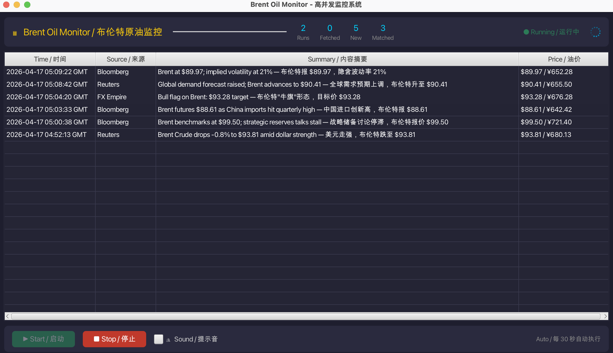

# Brent Oil Monitor / 布伦特原油监控系统

**Brent Crude News Monitor — a Java Concurrency Project**

A desktop application built with Java 17 + JavaFX that polls public RSS feeds every 30 seconds for Brent crude oil news. The pipeline is built on `java.util.concurrent`: a scheduler, a thread pool with CompletableFuture, a bounded blocking queue, Semaphore-based concurrency control, atomic variables and a concurrent map for de-duplication.

每 30 秒抓取多家公开 RSS 新闻源（OilPrice.com、Bloomberg、FX Empire），筛选布伦特原油相关新闻，并通过 JavaFX 界面实时展示。并发部分基于 `java.util.concurrent` 实现：定时调度、线程池 + CompletableFuture、有界阻塞队列、Semaphore 并发控制、原子变量与 ConcurrentHashMap 去重。

---

## Project Overview / 项目概述

Brent Oil Monitor fetches news from three RSS feeds in parallel every 30 seconds, removes duplicates, keeps items that mention Brent crude, and displays them in a real-time JavaFX table. Monitoring starts automatically when the app launches.

布伦特原油监控系统每 30 秒并发抓取 OilPrice.com、Bloomberg、FX Empire 三个 RSS 源，经过去重和布伦特关键词过滤后，在 JavaFX 表格中实时展示。应用启动后自动开始监控。

> **项目来源**：本项目起源于 UOACS x DEVS Hackathon 2026 期间的开发。比赛期间版本的新闻内容为演示数据，之后改为接入三个真实 RSS 源。

## Highlights | 项目亮点

- **Scheduled concurrent fetching** (ScheduledExecutorService every 30 s; 3 sources fetched in parallel with ThreadPoolExecutor + CompletableFuture)  
  **定时并发抓取**（ScheduledExecutorService 每 30 秒调度，ThreadPoolExecutor + CompletableFuture 并行抓取 3 个新闻源）

- **Producer–consumer pipeline** (ThreadPoolExecutor core 3 / max 6 → ArrayBlockingQueue(100) → consumer threads)  
  **生产者-消费者流水线**（ThreadPoolExecutor core 3 / max 6 → ArrayBlockingQueue(100) → 消费者线程）

- **Bounded buffering** (fixed-capacity queue; producers wait at most 1 s via `offer(item, 1s)` when it is full)  
  **有界缓冲**（固定容量队列；队列满时生产者通过 `offer(item, 1s)` 最多等待 1 秒）

- **Concurrency control with Semaphore** (caps the number of simultaneous fetches)  
  **基于 Semaphore 的并发数控制**（限制同时进行的抓取数）

- **Atomic variables and atomic de-duplication** (AtomicInteger / AtomicLong / AtomicBoolean CAS, `ConcurrentHashMap.putIfAbsent`)  
  **原子变量与原子去重**（AtomicInteger / AtomicLong / AtomicBoolean 的 CAS 更新，`ConcurrentHashMap.putIfAbsent`）

- **Live RSS fetching** (JDK `HttpClient` + DOM parser with XXE protections, keyword filtering)  
  **真实 RSS 抓取**（JDK `HttpClient` + 带 XXE 防护的 DOM 解析、关键词过滤）

- **Thread-safe UI updates** with `Platform.runLater()`  
  **通过 `Platform.runLater()` 实现线程安全的 UI 更新**

- **Orderly shutdown** (`shutdown()` → `awaitTermination()` → `shutdownNow()` timeout interrupt)  
  **有序关闭**（`shutdown()` → `awaitTermination()` → 超时 `shutdownNow()` 中断）

- **Build & packaging** with Maven (shaded JAR) and jpackage for macOS  
  **Maven（shaded JAR）构建 + jpackage 打包 macOS 应用**

## Architecture / 架构设计

```
┌──────────────────────────────────────────────────────────────────┐
│            MonitorScheduler (ScheduledExecutorService)           │
│                     scheduleAtFixedRate(30 sec)                  │
└──────────────────────────────┬───────────────────────────────────┘
                               │ coordinates / 协调调度
              ┌────────────────┴────────────────┐
              ▼                                 ▼
┌─────────────────────────┐       ┌──────────────────────────┐
│    FetcherRunner        │       │     NewsProcessor        │
│    (Producer Side)      │       │     (Consumer Side)      │
│                         │       │                          │
│  ThreadPoolExecutor     │       │  FixedThreadPool(CPU)    │
│  (core 3 / max 6)       │       │   └─ consumeLoop()       │
│   └─ OilPrice Fetcher   │       │                          │
│   └─ Bloomberg Fetcher  │ ────▶ │  1. Deduplication        │
│   └─ FXEmpire Fetcher   │ QUEUE │  2. Keyword Filter       │
│                         │ (100) │  3. Stats Update         │
│  Semaphore (3 permits)  │       │                          │
└─────────────────────────┘       └──────────────────────────┘
                                        │ Platform.runLater()
                                        ▼
                               ┌──────────────────────────┐
                               │    JavaFX TableView      │
                               │    (UI Thread)           │
                               │     Brent Monitor App    │
                               └──────────────────────────┘
```

## Demo | 项目截图



*界面截图（早期版本，截图中的新闻内容为当时的演示数据；当前版本已改用真实 RSS 源，界面布局不变）。*

---

## Concurrency Design / 并发设计要点

### 1. ScheduledExecutorService — 定时调度

```java
scheduledTask = scheduler.scheduleAtFixedRate(
    this::executeOnce, initialDelayMs, intervalMs, TimeUnit.MILLISECONDS);
```

- **场景：** 每 30 秒触发一轮"抓取 → 处理"，首轮延迟 3 秒
- **机制：** `MonitorScheduler` 持有一个 2 线程的 daemon 调度池；`AtomicBoolean.compareAndSet` 保证 `start()` / `stop()` 幂等；`executeOnce()` 内部捕获异常，一轮失败不会终止后续调度
- **价值：** 相比 `Timer`（单线程，任务延迟会拖慢后续任务），线程池版调度器更适合承载耗时的网络抓取

### 2. ThreadPoolExecutor + CompletableFuture — 并发抓取

```java
AtomicInteger counter = new AtomicInteger(1);
ThreadPoolExecutor executor = new ThreadPoolExecutor(
    3,                              // corePoolSize：对应 3 个新闻源
    6,                              // maximumPoolSize：允许临时扩容
    60L, TimeUnit.SECONDS,          // keepAliveTime
    new SynchronousQueue<>(),       // 不缓冲任务，直接交给线程
    r -> {                          // 命名的 daemon 线程：Fetcher-1, Fetcher-2 ...
        Thread t = new Thread(r, "Fetcher-" + counter.getAndIncrement());
        t.setDaemon(true);
        return t;
    },
    (r, e) -> System.err.println("任务被拒绝，线程池已饱和")   // 拒绝策略：记录日志
);

// 每个新闻源一个异步任务，等待本轮全部完成
List<CompletableFuture<List<NewsItem>>> futures = fetchers.stream()
    .map(f -> CompletableFuture.supplyAsync(() -> fetchWithLimiter(f), executor))
    .toList();
CompletableFuture.allOf(futures.toArray(new CompletableFuture[0])).join();
```

*（简化自 `FetcherRunner`。）*

- **场景：** 3 个 RSS 源的 HTTP 请求是阻塞式 IO，需要并行执行并汇总结果
- **机制：** 核心线程数与新闻源数量一致；`SynchronousQueue` 让任务直接交给线程，线程不足时才扩容到 max；`supplyAsync` 显式传入自定义线程池，`allOf().join()` 汇总一轮结果
- **价值：** 线程数有上限、线程有名字便于排查；阻塞 IO 不占用 `ForkJoinPool.commonPool()`

### 3. ArrayBlockingQueue — 生产者-消费者与有界缓冲

```java
BlockingQueue<NewsItem> queue = new ArrayBlockingQueue<>(100, true);   // 容量 100，公平模式
boolean accepted = queue.offer(item, 1, TimeUnit.SECONDS);             // 队列满时最多等待 1 秒
NewsItem next = queue.take();                                          // 消费者：队列空时阻塞
```

*（`NewsItemQueue` 对其做了封装。）*

| 场景 / Scenario | 行为 / Behavior |
|-----------------|-----------------|
| **生产者快、消费者慢** | 队列最多积压 100 条；队列满时生产者限时等待 1 秒，超时的条目被丢弃 |
| **生产者慢、消费者快** | 消费者在 `take()` 上阻塞等待，不占用 CPU |

- **场景：** 抓取（生产者）与过滤、去重、展示（消费者）速度不同
- **机制：** 数组实现的有界队列，`take()` 在空队列时阻塞；入队使用限时的 `offer`，而不是无限期阻塞的 `put`
- **价值：** 解耦两端、限制内存占用；资讯类数据在下一轮抓取时会再次出现，所以限时入队的取舍比较合适

### 4. Semaphore — 并发数控制

```java
TokenBucketRateLimiter limiter = new TokenBucketRateLimiter(3, 10);   // FetcherRunner 内部创建

limiter.acquire();            // 从公平模式的 Semaphore 获取许可，3 个许可用完则阻塞
try {
    // fetcher.fetch() ...
} finally {
    limiter.release();        // 归还许可
}
```

- **场景：** 限制同时发出的抓取请求数
- **机制：** `TokenBucketRateLimiter` 用 **Semaphore（3 个许可）** 控制并发数，`acquire()` 阻塞等待，`finally` 中归还许可
- **价值：** 防止线程与连接数失控。注意这是**并发数控制**（同一时刻最多几个），不是**QPS 限流**（单位时间最多几次）；类中基于 `AtomicLong` 的令牌计数与按秒补充逻辑，目前不参与阻塞

### 5. 原子变量与 ConcurrentHashMap — CAS 与原子去重

```java
// MonitorStats — 统计计数器
private final AtomicInteger runCount = new AtomicInteger(0);
public void incrementRun() { runCount.incrementAndGet(); }

// DeduplicationCache — 一次 putIfAbsent 同时完成"检查 + 插入"
private final ConcurrentHashMap<String, Boolean> cache = new ConcurrentHashMap<>();
public boolean isDuplicate(String contentHash) {
    return cache.putIfAbsent(contentHash, Boolean.TRUE) != null;
}
```

- **场景：** 多个消费者线程同时更新统计、判断新闻是否重复
- **机制：** `AtomicInteger / AtomicLong / AtomicBoolean` 基于 CAS（比较并交换），失败则重试，用于统计计数、新闻 ID、令牌计数和调度器运行状态；`putIfAbsent` 是原子的"不存在才插入"，返回非 null 表示已存在
- **价值：** 单变量的计数与状态更新无需 `synchronized`；避免"先 `get` 再 `put`"带来的竞态，两个线程不会同时把同一条新闻当作新数据
- 去重指纹为新闻内容的 `String.hashCode()`，缓存保存在进程内存中。
- **局限**：`hashCode` 只有 32 位，不同内容可能产生相同指纹，被误判为重复；缓存随进程退出而清空，重启后会重新展示旧新闻。如需更严格，可改用内容的 SHA-256 摘要或以新闻链接作键，并为缓存加过期策略。

### 6. Platform.runLater — UI 线程调度

```java
scheduler.setOnNewsAccepted(item -> Platform.runLater(() -> {
    newsData.add(item);       // ObservableList 只在 JavaFX Application Thread 上修改
}));
```

*（简化自 `MonitorUI.setupCallbacks()`。）*

- **场景：** 消费者线程产生的新闻与统计需要显示到界面
- **机制：** JavaFX 场景图只能在 Application Thread 上访问；后台线程把更新任务提交到 UI 线程的事件队列
- **价值：** 抓取、处理都在后台线程，界面保持响应，且不会在非 UI 线程直接修改控件

### 7. 线程池关闭 — shutdown / awaitTermination / shutdownNow

```java
executor.shutdown();                                   // 不再接收新任务
try {
    if (!executor.awaitTermination(5, TimeUnit.SECONDS)) {
        executor.shutdownNow();                        // 超时后中断仍在运行的线程
    }
} catch (InterruptedException e) {
    executor.shutdownNow();
}
```

*（取自 `FetcherRunner.shutdown()`。）*

- **场景：** 关闭窗口时释放调度池、抓取池和消费者池
- **机制：** `MonitorScheduler.shutdown()` 依次停止调度、关闭 `NewsProcessor` 与 `FetcherRunner`（等待 3 秒 / 5 秒）并关闭调度池；消费者阻塞在 `take()` 上，通过 `shutdownNow()` 的中断触发 `InterruptedException` 退出循环
- **价值：** 先等待、超时再中断，既给在途任务收尾的时间，也保证线程不会无限期挂起

---

## Architecture Description / 架构详解

### Package Structure / 包结构

```
com.brentmonitor/
├── model/            # 数据模型（NewsItem, MonitorStats）
├── scheduler/        # ScheduledExecutorService 调度编排
├── fetcher/          # NewsFetcher 接口 + FetcherRunner
│   └── impl/         # OilPrice.com、Bloomberg、FX Empire（共用 RSS 抓取基类）
├── queue/            # ArrayBlockingQueue 共享缓冲区
├── processor/        # Consumer：去重、关键词过滤、统计
├── cache/            # DeduplicationCache（ConcurrentHashMap）
├── limiter/          # TokenBucketRateLimiter（Semaphore）
├── ui/               # JavaFX MonitorUI（TableView + 控件）
└── util/             # Logger（日志写入 ~/BrentMonitor.log）
```

### Data Flow / 数据流

1. **MonitorScheduler** 通过 `scheduleAtFixedRate` 每 30 秒触发一轮抓取（应用启动后首轮延迟 3 秒）
2. **FetcherRunner** 向线程池提交 3 个抓取任务；每个任务先获取 Semaphore 许可，再通过带超时的 `HttpClient` 请求读取并解析 RSS，得到 `List<NewsItem>`
3. 抓取结果逐条 `offer` 到 **ArrayBlockingQueue**（队列满时最多等待 1 秒）
4. **NewsProcessor** 的消费者线程（数量等于 CPU 核数）调用 `take()` 取数据，队列为空时阻塞
5. 每条新闻先经 **DeduplicationCache** 去重，再做布伦特关键词匹配，同时更新原子计数器
6. 命中的新闻通过回调与 `Platform.runLater()` 推送到 **JavaFX TableView**，按发布时间倒序显示（最新在上，最多 200 条），时间统一显示为 GMT

### Keyword Filter / 关键词过滤

忽略大小写的子串匹配：`Brent crude`、`Brent oil`、`布伦特原油`、`布伦特`（见 `NewsProcessor.BRENT_KEYWORDS`）。

### RSS Sources / 新闻源

| 来源 / Source | Feed URL |
|---------------|----------|
| OilPrice.com | `https://oilprice.com/rss/main` |
| Bloomberg | `https://feeds.bloomberg.com/markets/news.rss` |
| FX Empire | `https://www.fxempire.com/api/v1/en/articles/rss/news` |

三个 Fetcher 共用同一个 RSS 抓取/解析基类（`RssNewsFetcher`，位于 `OilPriceNewsFetcher.java`）。新闻源由外部网站提供，可用性与内容格式以对方为准。

---

## Tech Stack / 技术栈

| 组件 / Component | 技术 / Technology |
|-----------------|------------------|
| Language / 编程语言 | Java 17 |
| GUI | JavaFX 17.0.13 (OpenJFX) |
| Concurrency / 并发 | java.util.concurrent |
| Network & Parsing / 网络与解析 | JDK `java.net.http.HttpClient`、JDK DOM 解析器 |
| Build Tool / 构建工具 | Maven（maven-shade-plugin 生成可执行 JAR） |
| Packaging / 打包 | jpackage (app-image) + hdiutil (DMG) |

**无第三方并发库** — 并发部分全部使用标准 `java.util.concurrent`。

---

## How to Run / 运行方式

### Prerequisites / 前置条件
- Java 17+（OpenJDK 或 Temurin）
- Maven
- 能够访问 RSS 站点的网络

### Run from source / 从源码运行

```bash
cd Brent-Oil-Monitor/brent-monitor

# Build / 构建
mvn clean package -DskipTests

# Run / 运行
java -jar target/brent-monitor-shaded.jar
```

构建产物为 `brent-monitor/target/brent-monitor-shaded.jar`（内含 JavaFX 依赖）。

> 注意：`build.sh` 和 `run.sh` 目前检查的是 `target/brent-monitor.jar`，与 `pom.xml` 实际生成的 `brent-monitor-shaded.jar` 不一致，请直接使用上面的 Maven 命令构建和运行。

---

## How to Build macOS App / macOS App 构建方式

`build-macos-app.sh` 使用 JDK 自带的 `jpackage`，JavaFX 模块取自本机 Maven 仓库（`~/.m2`），因此需要先用 Maven 构建一次。

### Step 1: 构建 shaded JAR

```bash
cd Brent-Oil-Monitor/brent-monitor
mvn clean package -DskipTests
```

### Step 2: 打包为 .app

```bash
cd ..    # 回到 Brent-Oil-Monitor 根目录
./build-macos-app.sh
```

脚本会检查 Java ≥ 17 与 `jpackage`，按 CPU 架构选择对应的 JavaFX jar，生成 app-image 并做 ad-hoc 签名，再用 `hdiutil` 生成 DMG。

输出文件：
- `dist/BrentMonitor.app` — macOS 应用包
- `dist/BrentMonitor.dmg` — macOS 安装包（若 `hdiutil` 可用）

### Manual jpackage command / 手动 jpackage 命令

对应 `build-macos-app.sh` 中的调用（Apple Silicon 示例，Intel Mac 将后缀改为 `-mac.jar`）：

```bash
REPO=$(mvn help:evaluate -Dexpression=settings.localRepository -q -DforceStdout)
V=17.0.13
SUFFIX=-mac-aarch64.jar
MODULE_PATH="$REPO/org/openjfx/javafx-controls/$V/javafx-controls-$V$SUFFIX:\
$REPO/org/openjfx/javafx-graphics/$V/javafx-graphics-$V$SUFFIX:\
$REPO/org/openjfx/javafx-base/$V/javafx-base-$V$SUFFIX"

jpackage \
  --type app-image \
  --input brent-monitor/target \
  --main-jar brent-monitor-shaded.jar \
  --dest dist \
  --name BrentMonitor \
  --app-version 1.0.0 \
  --vendor BrentMonitor \
  --description "Brent Crude Oil News Monitor" \
  --mac-package-identifier com.brentmonitor.app \
  --mac-package-name "Brent Monitor" \
  --module-path "$MODULE_PATH" \
  --add-modules javafx.controls,javafx.graphics
```

---

## Interview Highlights / 面试要点

### 1. 为什么用 ScheduledExecutorService，而不是 Timer？
> "每轮抓取要发网络请求，耗时不固定。`Timer` 是单线程，一个任务变慢会拖后续任务，且任务抛异常会让整个 Timer 终止。ScheduledExecutorService 基于线程池，我用 `scheduleAtFixedRate` 每 30 秒触发一次，`executeOnce()` 里捕获异常，一轮失败不影响下一轮。启停状态用 `AtomicBoolean.compareAndSet` 保证幂等。"

### 2. 线程池参数怎么定的？为什么用 SynchronousQueue？
> "核心线程数 3，对应 3 个新闻源，最大 6 用于临时扩容。队列选 SynchronousQueue：任务不排队，直接交给线程，线程不够再扩容到 max，所以线程池只负责'执行'，缓冲交给后面的 ArrayBlockingQueue。线程命名为 `Fetcher-N` 并设为 daemon，便于排查，也不会阻止 JVM 退出。"

### 3. CompletableFuture 在这里起什么作用？
> "每个新闻源对应一个 `supplyAsync` 任务，并显式传入自己的线程池，这样阻塞的 HTTP 请求不会占用 `ForkJoinPool.commonPool()`。调度线程用 `allOf().join()` 等一轮全部完成，再汇总结果、更新统计。"

### 4. 生产者-消费者模型：为什么需要队列？
> "抓取是低频、阻塞 IO，处理是 CPU 计算，两边速度不同。用容量 100 的 ArrayBlockingQueue 解耦：队列空时消费者在 `take()` 上阻塞，不占 CPU；队列满时生产者用 `offer(item, 1s)` 限时等待，超时丢弃。这是有界缓冲，目的是限制内存占用和积压。资讯数据下一轮抓取还会再出现，所以限时入队的取舍可以接受；如果数据不允许丢失，就改用 `put()` 做严格的阻塞式背压。"

### 5. Semaphore 和限流是一回事吗？
> "不是。Semaphore 控制的是'同时进行'的数量，我用公平模式、3 个许可，限制并发抓取数，线程阻塞在 `acquire()` 上，用完在 `finally` 里归还。QPS 限流控制的是'单位时间内'的请求数，通常用令牌桶或漏桶，按时间补充令牌。我的 `TokenBucketRateLimiter` 目前生效的是 Semaphore 并发控制。"

### 6. AtomicInteger 和 synchronized 有什么区别？CAS 是什么？
> "CAS 是比较并交换：读取当前值，只有它等于预期值才写入，否则重试，由 CPU 原子指令保证。`AtomicInteger` 适合单个变量的计数和状态更新，不需要加锁，也没有线程挂起的开销。我用它做统计计数，用 `AtomicLong` 生成新闻 ID，用 `AtomicBoolean` 管理调度器状态。多个变量需要保持一致时，CAS 就不够了，需要用锁。"

### 7. 去重为什么用 putIfAbsent？
> "多个消费者线程并发处理新闻。如果先 `get` 再 `put`，两个线程可能同时发现'不存在'，把同一条新闻都当成新数据。`ConcurrentHashMap.putIfAbsent` 把检查和插入合成一个原子操作，返回 null 表示是新内容，非 null 表示重复。指纹用的是内容的 `hashCode()`，实现简单；局限是 32 位哈希可能碰撞，且缓存只在内存，重启后清空。如需更严格，改用内容摘要或链接作键，并加过期策略。"

### 8. JavaFX 里为什么要用 Platform.runLater？
> "JavaFX 场景图不是线程安全的，只能在 Application Thread 上访问。抓取和处理都在后台线程，产生的新闻和统计通过 `Platform.runLater()` 提交到 UI 线程执行，TableView 的 `ObservableList` 只在 UI 线程上修改。这样既不阻塞界面，也不会在非 UI 线程直接操作控件。"

### 9. 程序关闭时线程怎么处理？
> "关闭窗口时依次停止调度、关闭消费者池和抓取池、关闭调度池。每个池都是先 `shutdown()` 停止接收新任务，再 `awaitTermination()` 等待一段时间，超时后 `shutdownNow()` 发中断。消费者阻塞在 `take()` 上，收到中断后抛出 `InterruptedException`，循环退出。"

### 10. 项目是怎么构建和打包的？
> "Maven 用 maven-shade-plugin 生成包含 JavaFX 依赖的可执行 JAR，`Main` 作为启动类调用 `Application.launch(MonitorUI.class)`。macOS 应用通过 `build-macos-app.sh` 调用 jpackage 生成 app-image，做 ad-hoc 签名后用 `hdiutil` 生成 DMG。"

---

## File Structure / 文件结构

```
Brent-Oil-Monitor/
├── brent-monitor/
│   ├── pom.xml
│   └── src/main/
│       ├── java/com/brentmonitor/
│       │   ├── Main.java
│       │   ├── model/
│       │   │   ├── NewsItem.java
│       │   │   └── MonitorStats.java
│       │   ├── scheduler/
│       │   │   └── MonitorScheduler.java
│       │   ├── fetcher/
│       │   │   ├── NewsFetcher.java
│       │   │   ├── FetcherRunner.java
│       │   │   └── impl/
│       │   │       ├── OilPriceNewsFetcher.java
│       │   │       ├── BloombergNewsFetcher.java
│       │   │       └── FXEmpireNewsFetcher.java
│       │   ├── queue/
│       │   │   └── NewsItemQueue.java
│       │   ├── processor/
│       │   │   └── NewsProcessor.java
│       │   ├── cache/
│       │   │   └── DeduplicationCache.java
│       │   ├── limiter/
│       │   │   └── TokenBucketRateLimiter.java
│       │   ├── ui/
│       │   │   └── MonitorUI.java
│       │   └── util/
│       │       └── Logger.java
│       └── resources/                   # 样式与图标资源
├── docs/
│   └── demo.png
├── dist/
│   └── BrentMonitor.dmg                 # macOS 安装包
├── build.sh
├── build-macos-app.sh
├── run.sh
└── README.md
```

---

## Testing & Known Limitations / 测试与已知限制

- **测试**：项目没有自动化测试，构建命令使用 `-DskipTests`。功能通过本地运行应用手工验证。
- **线程池上限**：抓取线程池 core 3 / max 6，使用 `SynchronousQueue`。每轮只提交 3 个抓取任务，core 为 3，所以实际线程数不会超过 3；`max 6` 是上限余量。
- **拒绝策略**：线程池饱和时只打印日志，任务不重试。
- **入队超时丢弃**：队列满时 `offer(item, 1s)` 超时的条目被丢弃。这是有界缓冲，不是严格背压；严格背压需改用 `put()`。
- **并发数控制**：`TokenBucketRateLimiter` 中生效的是 Semaphore（3 个许可），限制同时抓取数；它不是 QPS 限流。
- **去重**：指纹为 `hashCode()`，存在碰撞可能，缓存只在内存（见并发设计 §5）。
- **价格列**：RSS 源不提供价格，该列为占位值。
- **外部依赖**：新闻源由第三方网站提供，可用性与内容格式由对方决定。

---

## Configuration / 配置说明

参数直接写在源码中，修改后重新构建即可：

| 参数 / Parameter | 位置 / Location | 当前值 / Value |
|------------------|-----------------|---------------|
| 抓取间隔、首次延迟（秒） | `MonitorUI.start()`：`new MonitorScheduler(30, 3)` | 30、3 |
| 队列容量 | `MonitorScheduler`：`new NewsItemQueue(100)` | 100 |
| 最大并发抓取数（生效）、令牌补充速率（预留参数，不参与阻塞） | `MonitorScheduler`：`new FetcherRunner(queue, 3, 10)` | 3、10 |
| 消费者线程数 | `MonitorScheduler`：`Runtime.getRuntime().availableProcessors()` | CPU 核数 |
| 关键词 | `NewsProcessor.BRENT_KEYWORDS` | 见上文 |
| 界面最大显示条数 | `MonitorUI.setupCallbacks()` | 200 |

---

## UI Display / 界面说明

| 功能 / Feature | 说明 / Description |
|---------------|-------------------|
| ⛽ 实时新闻列表 | TableView 展示命中的新闻，最新消息在最上方 |
| 🕐 时间显示 | 所有时间统一转换为 GMT 格式（`yyyy-MM-dd HH:mm:ss GMT`） |
| 📊 统计面板 | 显示 Runs / Fetched / New / Matched；后三项为当前一轮的计数 |
| 💲 价格列 | RSS 源不提供价格，该列目前显示 `$0.00 / ¥0.00` |
| 🔔 提示音 | 可开启新消息到达提示音 |
| ▶️ 启停控制 | Start / Stop 按钮手动控制监控（启动后默认自动运行） |

---

## License

本仓库暂未附带 LICENSE 文件。
